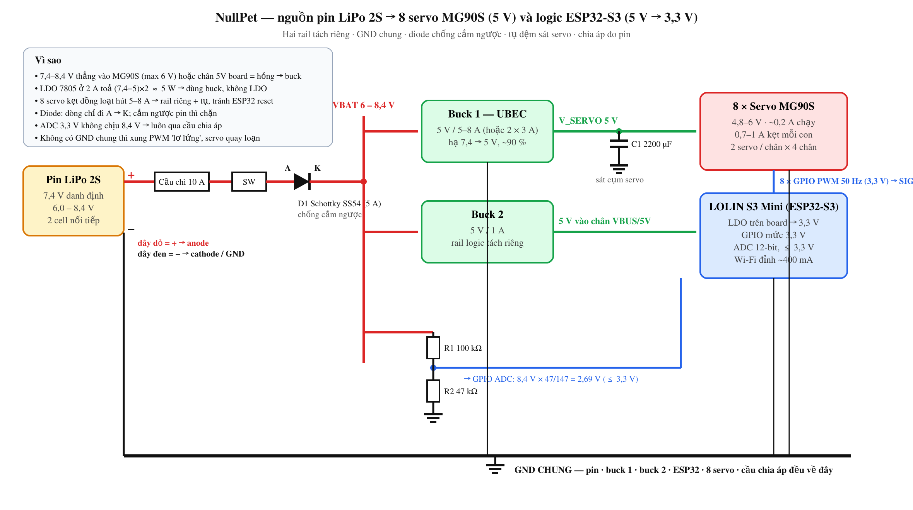

# Sơ đồ nguồn pin 2S → servo và logic ESP32-S3

> Tóm tắt 1 câu: pin LiPo 2S cho **6,0–8,4 V** — quá cao cho cả servo lẫn ESP32 — nên phải **hạ áp bằng buck** ra hai rail riêng (5 V cho servo, 5 V/3,3 V cho logic), **GND chung**, tụ lớn cạnh servo, và một diode chống cắm ngược ở đầu vào.

**Ngày tạo:** 2026-10-24
**Trạng thái:** 🟡 Đang học
**📖 Lộ trình:** Nhánh B · #5 ← cần [[diode-anode-cathode]] · → kế tiếp [[arduino-la-gi]]
**Chủ đề cha:** [[SECOND_BRAIN_IOT]]
**Tags:** #iot #dien-tu #nguon #servo #esp32

---

## 🔢 Số liệu phải biết trước khi vẽ

| Thứ | Giá trị | Nguồn số |
|---|---|---|
| Pin LiPo **2S** = 2 cell nối tiếp ([[mach-noi-tiep-song-song]]) | danh định **7,4 V** · đầy **8,4 V** · cạn **6,0 V** (3,0 V/cell, không xả thấp hơn) | hoá học Li-ion 3,7 V/cell |
| Servo **MG90S** (NullPet dùng **8 cái**) | 4,8–6 V · ~0,2 A chạy · **~0,7–1 A** kẹt mỗi con | datasheet |
| 8 × MG90S cùng lúc | đi bộ bình thường ~1–2 A · khởi động/kẹt đồng loạt **5–8 A** | nhân lên |
| Servo MG996R (tham khảo, lớn hơn) | 4,8–7,2 V · ~0,5 A · **~2,5 A** kẹt | datasheet |
| **LOLIN S3 Mini** (ESP32-S3FH4R2) | vào **5 V** (USB-C / chân VBUS) → LDO 3,3 V trên board; **GPIO 3,3 V** | datasheet |
| Dòng ESP32-S3 | ~50 mA nghỉ · **~300–400 mA** đỉnh khi phát Wi-Fi | datasheet |

Ba kết luận: (1) **không** cấp 7,4 V thẳng vào servo hay chân 5V của board; (2) servo kẹt kéo dòng gấp 3–5 lần lúc chạy → sụt áp sẽ **reset ESP32** nếu chung rail không có đệm; (3) với **8 servo**, buck cho servo phải cỡ **5 V / 5–8 A** (hoặc hai UBEC 3 A, mỗi cái nuôi 2 chân), không phải loại 3 A cho một servo.

## 🖼️ Sơ đồ



```
 Pin 2S  ──[Cầu chì 10 A]──[SW]──[D1 Schottky A▶K]──┬── VBAT 6–8,4 V       (dây đỏ = +, dây đen = −)
 7,4 V                                              │
                                                    ├──► Buck 1 (UBEC 5 V / 5–8 A) ──┬── V_SERVO 5 V ──► 8 × MG90S V+
                                                    │                                └── C1 2200 µF (sát cụm servo)
                                                   │
                                                   ├──► Buck 2 (5 V / 1 A) ──────────► ESP32-S3 chân 5V → LDO → 3,3 V
                                                   │
                                                   └──[R1 100 kΩ]──┬──► GPIO ADC (đo pin, ≤ 2,7 V)
                                                                   └──[R2 47 kΩ]── GND
 ESP32 GPIO (PWM 50 Hz, 3,3 V) ──────────────────────────────────────► Servo SIG
 GND pin ═══ GND buck 1 ═══ GND buck 2 ═══ GND ESP32 ═══ GND servo      ← GND CHUNG
```

## 💡 Vì sao từng linh kiện có mặt

| Linh kiện | Việc | Bỏ đi thì sao |
|---|---|---|
| **Cầu chì 10 A** | pin LiPo có thể phóng > 20 A khi chập; 8 servo chạy bình thường 1–2 A, đỉnh 5–8 A | dây cháy, pin phồng |
| **D1 Schottky** (SS34 chịu 3 A; với 8 servo dùng **SS54/SR560 5 A** hoặc P-MOSFET) | chống cắm ngược pin — A về cực +, K vào mạch ([[diode-anode-cathode]]); sụt chỉ ~0,3 V | cắm ngược một lần là chết buck + ESP32 |
| **Buck 1 — UBEC 5 V / 5–8 A** cho 8 servo | hạ 7,4 → 5 V hiệu suất ~90 %; chịu dòng kẹt đồng loạt | LDO 7805 ở 2 A toả `(7,4−5)×2 ≈ 5 W` — bỏng tay, sập áp; UBEC 3 A thì sập khi 4 chân cùng đạp |
| **Buck 2 — 5 V/1 A** cho ESP32 | rail logic **tách khỏi** rail servo | servo kẹt → sụt áp → ESP32 brownout reset giữa lệnh |
| **C1 2200 µF** sát cụm servo (hoặc 470 µF mỗi cặp chân) | đệm xung dòng khi 8 servo khởi động cùng lúc | servo giật, buck gợn, ESP32 có thể vẫn reset |
| **R1/R2 100 k/47 k** | chia 8,4 V xuống `8,4 × 47/147 = 2,69 V` cho ADC 3,3 V ([[uart-crossover-va-chia-ap]] cùng công thức) | không biết pin còn bao nhiêu, xả quá 6 V hỏng pin |
| **GND chung** | mốc điện áp duy nhất cho tín hiệu PWM | servo nhận xung "lơ lửng", quay loạn |

**Tín hiệu servo 3,3 V có đủ không?** Đa số servo hobby nhận HIGH ≥ 2,4–3 V nên ESP32 lái thẳng được; MG996R đôi khi kén — nếu giật, thêm transistor/level shifter.

## ⚙️ Hai phương án cho NullPet

| | A · Một UBEC lớn | B · Hai UBEC 3 A chia đôi |
|---|---|---|
| Servo | 8 con chung một UBEC 5 V / 8 A | mỗi UBEC nuôi **2 chân (4 servo)** |
| Ưu | ít linh kiện, một GND rail | một bên kẹt không kéo sập bên kia; UBEC 3 A rẻ, sẵn |
| Nhược | UBEC 8 A to, đắt | hai tụ, hai dây, phải chia GND đều |
| Chung | rail logic vẫn **tách riêng** (Buck 2); GND chung; tụ sát servo | |

Thử nghiệm bàn với 1–2 servo thì một UBEC 3 A là đủ; lắp đủ 4 chân mới cần phương án A/B.

## ⚠️ Điều dễ nhầm

- Nuôi servo từ chân **5V/3V3 của ESP32 board**: LDO trên board chỉ ~500 mA → sập ngay khi servo khởi động. Chân 5V của board là **đầu vào**, không phải nguồn cho tải.
- Nối ADC thẳng vào VBAT "để đo pin": 8,4 V vào chân 3,3 V → chết GPIO. Luôn qua cầu chia áp.
- Quên xả pin dưới 6,0 V: LiPo xả sâu không hồi được; cài ngưỡng cảnh báo 6,6 V (3,3 V/cell) trong code.
- Tin "buck tự lọc nhiễu": servo là tải xung, phải có tụ **ngay cạnh** servo, không phải cạnh buck.
- Dùng 2S vì "servo 7,2 V max": MG996R chịu 7,2 V nhưng pin đầy là **8,4 V** — vẫn phải buck. MG90S chỉ tới 6 V.
- Tính UBEC theo dòng **chạy** (1–2 A) thay vì dòng **kẹt đồng loạt** (5–8 A): robot ngã hoặc kẹt chân là lúc cần dòng nhất, và cũng là lúc dễ reset nhất.
- Nối dây: **đỏ = +**, **đen = −** ([[diode-anode-cathode]]); jack XT60/JST của pin 2S đã theo màu này.

---

## 🔗 Liên kết
- **Tiền đề:** [[diode-anode-cathode]] · [[dinh-luat-ohm]] · [[mach-noi-tiep-song-song]]
- **Dẫn tới:** [[arduino-la-gi]]
- **Liên quan:** [[ham-map-va-servo]] · [[du-an-esp32-mcp]] (bộ phần cứng dùng sơ đồ này) · [[uart-crossover-va-chia-ap]]

## ❓ Câu hỏi mở
- Thay D1 bằng P-MOSFET chống ngược (gần 0 V sụt) có đáng với dòng 3 A không?
- Có nên thêm mạch bảo vệ xả sâu bằng phần cứng (BMS 2S) thay vì tin vào code?

## 📚 Nguồn
- Ghi chú buổi học 2026-10-24 — bài tập vẽ sơ đồ nguồn 2S → servo/logic
- Datasheet SG90, MG996R, ESP32-S3-DevKitC
